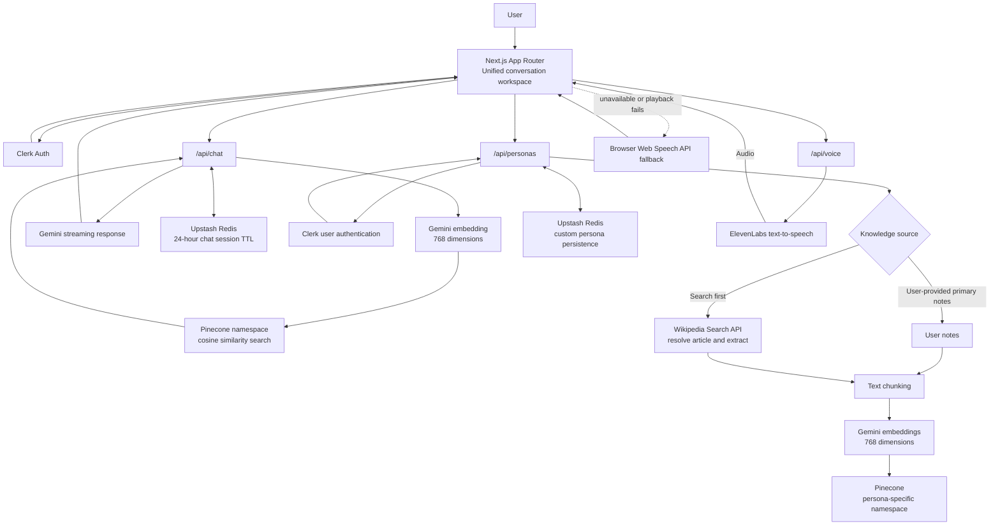

# TimelessTalk

TimelessTalk is an AI-powered conversation workspace where you can talk with historical and legendary personas grounded in curated source material. Create private personas from your own notes or summon someone new with knowledge enriched from Wikipedia.

**Live demo:** [timelesstalk.vercel.app](https://timelesstalk.vercel.app/)

## Key Features

- **Curated personas:** 10 historical and legendary personas with RAG-backed knowledge seeded into isolated Pinecone namespaces.
- **Summon Anyone:** Create a persona instantly; the app searches Wikipedia first and enriches it with retrieved source material.
- **Private personas:** Create custom personas and provide your own primary notes as their knowledge source.
- **Serverless persistence:** Upstash Redis stores chat sessions with a 24-hour TTL and persists custom personas.
- **Authentication and voice:** Clerk authentication protects persona creation. ElevenLabs provides cinematic text-to-speech, with automatic browser Web Speech API fallback when voice generation or playback is unavailable.

## Architecture



## Tech Stack

| Technology | Role | Architectural rationale |
| --- | --- | --- |
| Next.js App Router | Web app, unified chat workspace, and API routes | Keeps the interactive product and server-side integrations in one deployable application. |
| React and TypeScript | User interface and application logic | Component-based UI with typed contracts across client and server code. |
| Tailwind CSS | UI styling | Utility-first styling supports a cohesive, responsive workspace. |
| Clerk | Authentication | Provides managed sign-in and protects private persona creation and management. |
| Google Gemini via AI SDK | Persona generation, embeddings, and streaming chat | Uses one model provider for persona profiles, 768-dimensional retrieval embeddings, and streamed responses. |
| Pinecone | Vector storage and retrieval | Cosine similarity search retrieves relevant passages within each persona's isolated namespace. |
| Upstash Redis | Serverless persistence | Stores custom personas and chat history without requiring application-managed database servers; chat history expires after 24 hours. |
| Wikipedia Search API | Summoned-persona knowledge enrichment | Resolves a likely article before fetching an extract, grounding a new persona in a relevant public source. |
| ElevenLabs and Web Speech API | Text-to-speech | ElevenLabs generates expressive audio; browser speech synthesis keeps voice playback available when the service or audio playback fails. |

## Local Setup

### Prerequisites

- Node.js and npm
- A Google AI API key
- A Pinecone API key
- Clerk application keys
- Upstash Redis REST credentials
- An ElevenLabs API key for hosted text-to-speech (optional; browser speech synthesis is used as a fallback)

### Install and configure

```bash
git clone https://github.com/Charishma-Bailapudi/timelesstalk.git
cd timelesstalk
npm install
```

Create a `.env.local` file in the project root:

```dotenv
GOOGLE_GENERATIVE_AI_API_KEY=your-google-generative-ai-api-key
PINECONE_API_KEY=your-pinecone-api-key
PINECONE_INDEX_NAME=timelesstalk

NEXT_PUBLIC_CLERK_PUBLISHABLE_KEY=your-clerk-publishable-key
CLERK_SECRET_KEY=your-clerk-secret-key

UPSTASH_REDIS_REST_URL=https://your-upstash-redis-url
UPSTASH_REDIS_REST_TOKEN=your-upstash-redis-token

# Optional: omit to use browser speech synthesis when voice is requested.
ELEVENLABS_API_KEY=your-elevenlabs-api-key
```

Keep `.env.local` private and never commit real credentials.

The seed script creates the Pinecone index if it does not exist. It requires the Google and Pinecone keys; `PINECONE_INDEX_NAME` defaults to `timelesstalk` when omitted. Configure Clerk and Upstash to enable authentication and persona/chat persistence.

Seed the built-in persona knowledge, then start the development server:

```bash
npm run seed:all
npm run dev
```

Open [http://localhost:3000](http://localhost:3000) to use TimelessTalk.
